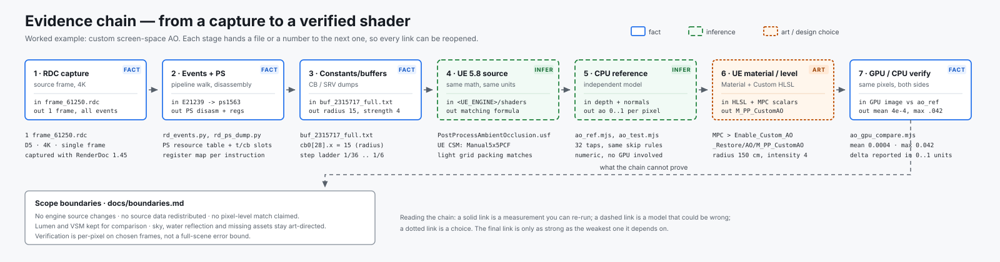
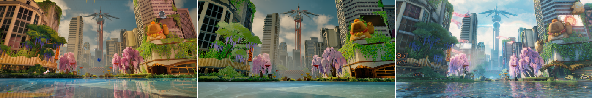
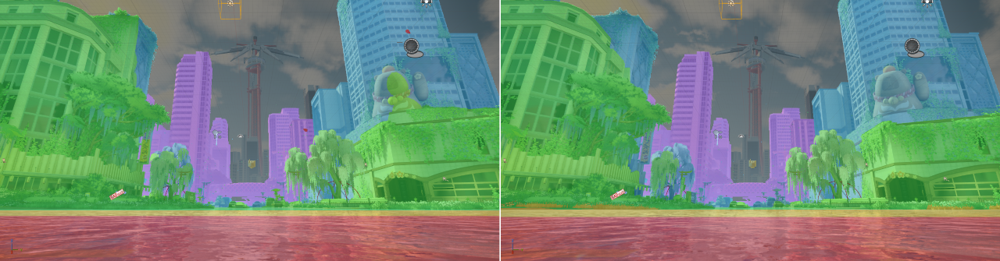
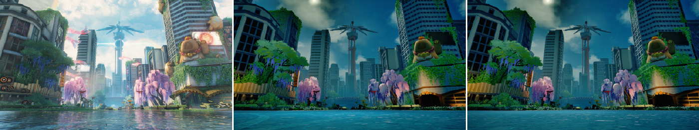
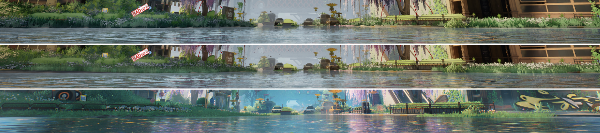

# 鸣潮 · 水岸高塔光照逆向

Lighting reconstruction of a Wuthering Waves waterfront scene in Unreal Engine 5.8


左边是 UE 5.8 里还原后的视口截图，右边是鸣潮同一机位的画面。

> 个人研究项目，与库洛游戏（Kuro Games）无关。游戏名称、画面和资产的权利归原权利人，对比图只用于说明研究方法。原创代码、HLSL、工具和文档以 MIT 发布，详见 [NOTICE](NOTICE.md)。

## English summary

A lighting study of one Wuthering Waves waterfront scene, rebuilt in Unreal Engine 5.8 from a RenderDoc capture with materials and Custom HLSL only. Comparing the capture's shaders with the UE 5.8 source showed that the renderer is UE4-derived: its clustered light grid, cascaded shadow filtering and single-layer water use UE's own formulas. Shadows, light culling and water therefore became parameter matching that could be checked against data. Screen-space AO was reimplemented as a post-process material, and the ground grass was rebuilt from the mesh data in the capture. Results are checked with CPU reference implementations, GPU readback and side-by-side viewport captures. The repository holds write-ups, HLSL and tools; the UE project, captures and game assets are not included.

## 项目在做什么

我从《鸣潮》一个水岸街景的 RenderDoc 截帧出发，想弄清这一帧的光照是怎么组织的，再把其中能拿到证据的部分在 UE 5.8 里重建出来。

给自己定的限制是只用材质和 Custom HLSL，不改引擎源码，也不写 C++ 或 Global Shader。这个限制决定了哪些东西能自己实现。屏幕空间的效果可以写成后处理材质；阴影贴图的采样和灯光剔除都在引擎内部，材质层碰不到，只能在引擎现有实现上调参数，再想办法证明参数对上了。

下面介绍其中五个模块：屏幕空间 AO、级联阴影（CSM）、聚簇光照、水面和地表植被。

## 从反汇编到 UE 源码

逆向阶段主要靠逐条读 shader 反汇编。到了 UE 里做阴影和聚簇光照对照时，我开始把 shader 里的公式和常数拿到 UE 5.8 源码里搜，结果一项项都对上了：聚簇的深度切片公式和常数、灯光数据的打包方式、阴影的 5×5 PCF 滤波、水面的 shading model 编号，在 UE 源码里都有同名的实现。由此判断鸣潮是在 UE4 的延迟管线上改出来的。

这个判断让原来的计划改了不少。我最初以为 UE 最多只支持 4 级级联，聚簇光照在延迟管线里用处不大，水面的吸收也得自己写；对照源码之后，这几条都不成立。阴影、聚簇和水面在两边本来就是同一套算法，工作重点变成把参数对齐，再拿数据证明对齐了。需要从头写的，主要剩下 AO 这类实现方式不同、UE 又不暴露中间结果的部分。

之后读鸣潮 shader 的习惯也变了：先去引擎源码里找同名公式，找不到再读反汇编，快得多。

## 怎么确认一个结论



一个结论一般按这个顺序确认：在截帧里定位到具体的 draw 或 dispatch，导出常量和缓冲拿到实际数值，去 UE 源码里找对应实现，先用 Node 写一份 CPU 参考实现，再写进 UE 材质，最后对比结果。水面和植被这类以参数和资产为主的模块，最后一步换成同机位截图和区域统计。

先写 CPU 参考，是因为后处理材质很难调试。在 Node 里可以构造答案已知的合成场景，比如平地不该被遮挡、墙角应该比空地暗，数学先在这里过关。之后把同一段 HLSL 渲染到 RenderTarget 读回来，和 CPU 结果逐像素比，这样能把“公式写错”和“UE 里的输入取错”分开排查。

画面判断只用编辑器的真实视口截图。早期我用 SceneCapture 一次性截图做对比，后来发现它会跳过后处理材质，曝光和 Lumen 反射也和视口不一样。有一次视口已经整片过曝，截图看起来却很正常。基于这类截图得出的几条结论，后来都推翻重做了。



从左到右：编辑器视口、SceneCapture 截图、鸣潮原画面。

文档里用 `[事实]`、`[推断]`、`[美术]` 标出每条结论的依据，把“鸣潮是怎么做的”和“我在 UE 里怎么近似”分开写。方法的完整说明见 [docs/architecture.md](docs/architecture.md)。

## 五个模块

### 屏幕空间 AO

鸣潮的 AO 在法线半球里沿 8 个方向各走 4 步，分三个分辨率依次计算，再和上一帧混合。后处理材质拿不到上一帧，也没法单独在低分辨率上运行，所以我保留了采样结构，去掉了多级计算和时域累积，让每个像素按位置旋转一次采样方向，剩下的噪声交给 UE 自带的 TAA。

调试主要靠 CPU 参考实现。测试里发现过一个问题：采样偏移量最初按 AO 半径取，半径一小，平地就会把自己遮住。原因是采样点会对齐到像素格，读到的深度和真实表面有偏差，视线越斜偏差越大，所以偏移量应该跟着一个像素覆盖的深度范围走。改完之后，GPU 输出和 CPU 参考逐像素比，平均误差在千分之一上下。

数学已经验证过，在真实场景里的观感还没有做最终的视口验收。


代码：[hlsl/pp_custom_ao.hlsl](hlsl/pp_custom_ao.hlsl) · [tools/analysis/ao_ref.mjs](tools/analysis/ao_ref.mjs) · 说明：[docs/ambient-occlusion.md](docs/ambient-occlusion.md)

### 级联阴影（CSM）

鸣潮用 5 级级联，阴影过滤和 UE 的 5×5 PCF 一致，两边的差别只在每一级覆盖多远。鸣潮的分段距离是写死的一组数，相邻两级的倍率并不固定；UE 只用一个指数生成全部分段，没法完全复现。我写了个小脚本搜索指数和总距离，误差最大的一级差了不到两成。

为了方便对比，我做了不用重启编辑器就能切换的三种模式（VSM、UE 默认 CSM、对齐后的 CSM），还写了一个调试材质，把两边的级联范围按深度涂成色带叠在画面上。阴影边缘的软硬在不同截图方式下给我的印象不一致，所以最后只拿色带边界的位置作为判断依据。



左边按鸣潮的分段着色，右边是 UE 当前的分段。

代码：[tools/analysis/csm_fit.mjs](tools/analysis/csm_fit.mjs) · [tools/ue/ue_csm_mode.py](tools/ue/ue_csm_mode.py) · 说明：[docs/csm.md](docs/csm.md)

### 聚簇光照

鸣潮的聚簇参数和 UE 的默认值一样，配置上没有要调的，值得做的是证明两边算出来的结果一致。

我从截帧的灯光缓冲里解出这一帧的 35 盏局部灯，放进关卡。关卡本来就是按鸣潮的世界坐标重建的，灯的位置可以直接用。然后从两个角度检查。一是照亮的东西对不对：鸣潮那边取灯光 Pass 前后的差分，UE 这边做开灯和关灯的差分，被照亮的是同一批物体。二是每个像素受几盏灯影响：按 UE 源码的剔除逻辑写一份 CPU 版本，输入用鸣潮自己的灯光数据和网格常数，再和 UE 实际运行的 Light Grid 调试输出逐像素比。九成以上像素完全一致，其余只差一盏灯，集中在远处的深度切片，原因是关卡里没有放源帧那几个反射探针。

局部灯的整体亮度比鸣潮偏高，原因还没查清。


代码：[tools/analysis/cluster_ref.mjs](tools/analysis/cluster_ref.mjs) · [tools/analysis/cluster_cmp.mjs](tools/analysis/cluster_cmp.mjs) · 说明：[docs/clustered-lighting.md](docs/clustered-lighting.md)

### 水面

我原本打算在材质里自己写水体吸收。后来发现鸣潮的水面就是 UE 的 Single Layer Water，关卡里的水恰好也是，事情就简单了：从截帧里读出散射、吸收和相位参数，填进关卡水材质的一个副本，加一个开关，关掉时和原材质完全相同。

波浪没有改。鸣潮用 FFT 算的海浪只在像素着色器里当法线用，顶点并不移动，UE 关卡里滚动的法线贴图在结构上更接近，加顶点波反而会偏离证据。

参数填进去之后水体变深，看不到水底了；再调过一轮高光、粗糙度和波纹强度，倒影被波纹拉成竖条的样子也和鸣潮接近了。剩下的差距主要来自倒影里的天空，和吸收参数关系不大。目前只改了主水面。



从左到右：鸣潮、UE 原有近似、填入鸣潮参数。三张的天空和时段不完全一致，只比较水体本身。

代码：[tools/ue/ue_water_restore.py](tools/ue/ue_water_restore.py) · 说明：[docs/water.md](docs/water.md)

### 地表植被

关卡里原来的地表草是又大又硬的尖叶簇，和鸣潮差得很远。我在截帧里找到草的 draw，发现只有两种网格，每种都由三张卡片围成一个三角形，共用一张图集。网格直接用截帧里的顶点、索引和 UV 重建，每株的缩放和朝向按截帧里的分布重新采样。

草的位置没能还原。截帧里实例坐标所在的空间没有解开，所以仍然用程序化撒点，再按地面重新贴地，去掉被路面和花箱压住的、孤立的实例，补上一块原来没草的草坪。颜色也只能折中：鸣潮的草色会乘一张按世界坐标采样的地表色图，UE 这边的材质是从根到梢的渐变，阴面和阳面没法同时对准。校准时我拍有草和无草两张截图，只统计差分出来的草像素。

从高处俯视时，花坛边缘的卡片会缩成一根根深色的棍子。这是源网格本身的特点，鸣潮的玩家视角基本是平视，很少碰到。植被已经实现，还在等视口里的最终验收。



从上到下：改前、改后、鸣潮。

代码：[tools/ue/ue_veg_restore.py](tools/ue/ue_veg_restore.py) · [tools/analysis/veg_build_mesh.mjs](tools/analysis/veg_build_mesh.mjs) · 说明：[docs/vegetation.md](docs/vegetation.md)

## 我做了什么

- 用 RenderDoc 分析截帧，切分渲染阶段，读 shader 反汇编和常量，并通过对照 UE 源码判断出渲染器的来源。
- 在 UE 5.8 里用材质和 Custom HLSL 实现 AO，对齐阴影、聚簇光照和水面的参数，重建地表草。
- 写了一套自动化工具：通过 WebSocket 桥接驱动 UE 编辑器，批量建材质、改参数、拍视口截图；另有 RenderDoc 批处理脚本和不依赖第三方库的 PNG 对比工具。
- 为每个模块设计验证方法，包括 CPU 参考实现、GPU 回读对比、同机位截图和区域统计。

项目由我个人完成。UE 材质、Python 自动化脚本的编写和文档整理借助了 AI 编程助手，技术判断、实验设计、结果验证和验收由我负责。

## 没做到的部分

整帧画面没有对齐，天空和后处理调色差得最多，所以上面的对比图只看结构和对应关系，不看整体色调。各模块的情况：

- AO 是单 Pass 近似，真实场景的观感还没验收。
- 阴影的级联边界仍有误差，UE 的单指数分段做不出源帧那种不等比的分布。
- 聚簇光照远处的切片和源帧不一致；局部灯偏亮的原因没查。
- 水面只改了主水面，没有做 FFT 海浪。
- 植被的位置是程序化的，俯视时有伪影。
- 角色渲染（NPR、描边）不在这个项目的范围内。

完整说明见 [docs/boundaries.md](docs/boundaries.md)。

## 仓库内容

- `docs/`：各模块的分析与实现说明，以及方法、工具链和边界。
- `hlsl/`：UE Custom 节点里的 HLSL 代码。
- `tools/`：UE 编辑器自动化、离线分析、RenderDoc 批处理和图片工具，说明见 [tools/README.md](tools/README.md)。
- `config/`：渲染设置摘录和环境变量模板。

仓库不包含 UE 工程、RDC 截帧、游戏资产或任何从游戏导出的数据。纯 Node 的工具可以直接运行：

```bash
node tools/analysis/ao_test.mjs   # AO 合成场景测试
node tools/analysis/csm_fit.mjs   # 级联分段拟合
```

UE 相关的脚本需要本地有 UE 5.8 工程和 UE_MCP_Bridge 插件，属于参考实现。复制 [config/tools.env.example](config/tools.env.example) 并填好路径后，可以这样连接编辑器：

```bash
node tools/ue/ue.mjs get_bridge_capabilities
bash tools/ue/vpshot.sh out/shot.png <x> <y> <z> <pitch> <yaw>
```

## 许可

原创代码、HLSL、工具和文档以 MIT 发布，见 [LICENSE](LICENSE)。游戏名称、画面、角色、场景和资产的权利归原权利人，不在 MIT 范围内，详见 [NOTICE](NOTICE.md)。Unreal Engine 属于 Epic Games，RenderDoc 属于 Baldur Karlsson。
