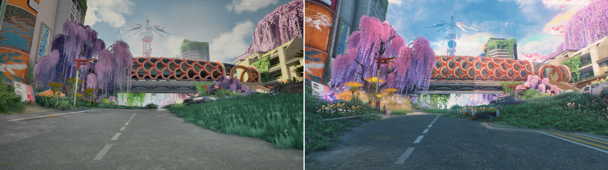
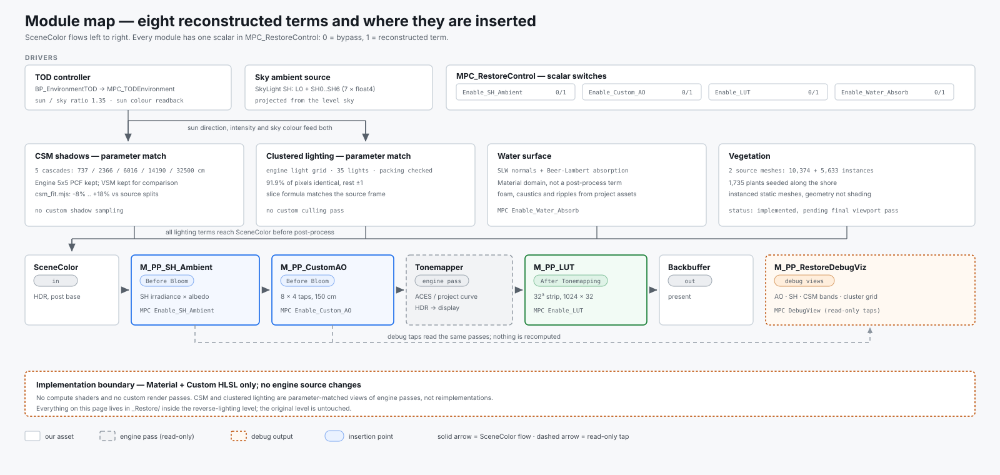
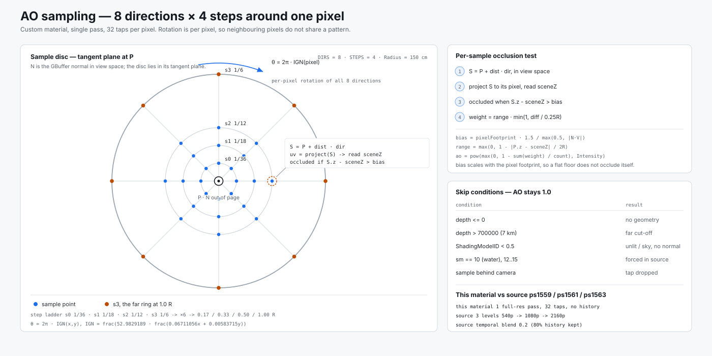
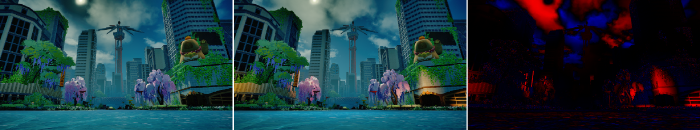
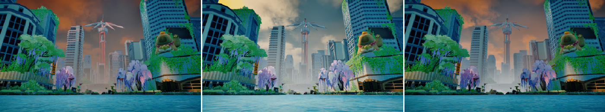

<div align="center">

# 鸣潮 · 水岸高塔光照逆向
### Wuthering Waves · Waterfront Tower Lighting Reconstruction

从 RenderDoc 截帧逐常量拆解 UE4 系延迟光照，在 Unreal Engine 5.8 中重实现 8 个模块。

`Unreal Engine 5.8` · `Material + Custom HLSL` · `RenderDoc 1.45` · `MIT`

</div>



*左：UE 5.8 还原（TOD + 35 盏局部灯 + CSM 参数对齐 + 植被）；右：鸣潮同机位。视口截图。SH / LUT / AO 为后处理材质，独立开关对比见各模块文档。*

> 个人研究项目，与库洛游戏（Kuro Games）无关。游戏名称、画面与资产权利归原权利人；对比图仅用于研究方法说明。原创代码、HLSL、工具、文档与示意图以 MIT 发布，详见 [NOTICE](NOTICE.md)。

> 状态：8 个模块已落地；LUT / AO / 植被待最终视口验收。最后更新：2026-11。

---

## TL;DR

A personal R&D project that reverse-engineers a Wuthering Waves waterfront scene from a RenderDoc D3D11 capture and rebuilds its lighting in Unreal Engine 5.8 using Materials + Custom HLSL only. The source renderer is identified as UE4-family at the constant level: the clustered light grid, 5-cascade CSM and Single Layer Water match UE's own formulas. I reimplemented SH sky irradiance, a 32³ color LUT and single-pass SSAO as UE materials, decoded 35 local lights, aligned TOD, and rebuilt the source grass meshes. Validation is CPU-reference based: AO mean error 0.0003–0.0011, LUT 0.7–1.0/255, light-grid 91.9% exact. This is a curated evidence portfolio, not a playable remake; the UE project, RDC captures and raw game assets are not included.

---

## 结果速览

| 模块 | 源证据 | UE 实现 | 验证 | 残余差距 |
| --- | --- | --- | --- | --- |
| **SH 天光** | 7×`float4` 球谐，`ps1037297` | `MF_SH_Irradiance` + `M_PP_SH_Ambient` | 天空 6 面投影，立体角积分误差 **0.01%** | 叠加而非替代 SkyLight/Lumen；强度/颜色校准仍未定 |
| **32³ LUT** | 五步烘焙，`ps1105708` / `ps1620` | `T_LUT_MC_SuiBo` + `M_PP_LUT` | GPU 查表 vs CPU **0.7–1.0/255** | ACES 默认关；`midLift` 是经验曲线 |
| **屏幕空间 AO** | 8 方向×4 步，三级+时域，`ps1559/61/63` | `M_PP_CustomAO` | GPU vs CPU 平均 **0.0003–0.0011** | 单 Pass，无金字塔/时域 |
| **CSM** | 5 级、5×5 PCF，`ps1024669` | `ue_csm_mode.py` + 级联色带 | 拟合 737/2366/6016/14190/32500 cm，误差 **−8%~+18%** | UE 单指数无法完全匹配 |
| **聚簇光照** | 60×34×32 Light Grid，`cs1073371` | 35 盏灯落地 + CPU 复刻 | 与 UE Light Grid 逐像素 **91.9%** 一致，其余 ±1 | UE5 HZB/链表；8 个反射探针缺失 |
| **水面** | UE Single Layer Water，`ps1072812` | `MI_Water_Restore_SLW` | 开关响应 + 同机位对比 | 只改一片；无 FFT；折射/SSR 用 UE 自带 |
| **TOD** | 太阳方向/颜色/角半径，`ps7051/ps1572` | `CT_Restore_TOD` + `ue_tod_apply.py` | 地面太阳色回读 (4.3366, 3.0677, 1.4666)，太阳/天光比 **1.35** | 只有 14.5 时有证据；雾高度衰减未映射 |
| **植被** | 2 种源草网格，10,374 + 5,633 实例 | `SM_WWGrass_TriCard_A/B` + 程序化撒布 | 改前/改后/同机位 + 颜色统计 | 分布是程序化近似；俯视外缘有“格子棍” |

---

## 这不是“调得像”

这次还原最重要的判断是：**鸣潮的渲染器是 UE4 系**。不是“像 UE”，而是逐项对得上 UE 源码：

| 鸣潮证据 | UE 对应 | 结论 |
| --- | --- | --- |
| 聚簇深度切片 `log2(z·B+O)·S`，`S=4.05` | `LightGridInjection.cpp` 的 `GetLightGridZParams` | [事实] 同公式、同常数 |
| 60×34×32、64px、每簇 32 | `r.Forward.LightGridPixelSize` 等默认值 | [事实] 默认值完全一致 |
| 灯色打包、点光哨兵值、矩形灯标志位 | `PackLightColor` / `PackedPreProcAngleAndFlags` | [事实] 数据布局一致 |
| CSM 5×5 PCF，9 次 `gather4` | `ShadowFilteringCommon.ush` 的 `Manual5x5PCF` | [事实] 逐行对应 |
| 水面 shading model ID = 10 | `ShadingCommon.ush` 的 `SHADINGMODELID_SINGLELAYERWATER` | [事实] 水面 = UE SLW |

因此，**CSM / 聚簇 / 水面** 不是“近似替代”，而是同一套算法的参数对齐；**SH / LUT / AO / 水体吸收** 是在 UE 材质层重实现。全程没有修改引擎源码，没有写 C++ 或 Global Shader。

---

## 证据链


每个结论都尽量走完同一条链：

1. **RenderDoc 截帧** → 事件表、Pass 切分、PS/CS 反汇编、常量缓冲、资源 ID；
2. **渲染模型** → 13 阶段渲染链，判断哪些阶段对应 UE 的哪个模块；
3. **UE 源码对照** → 在 UE 5.8 源码里找同名公式/常数，确认“同源”还是“近似”；
4. **CPU 参考实现** → 先把数学写成可单测的 JS/Python，再用合成场景验证；
5. **UE 材质/关卡** → Material Function、Custom Node、MPC、PPV、关卡 Actor；
6. **GPU/CPU 验证** → RT 回读逐像素比对 + 同机位视口截图 + 分带统计。

文中用 `[事实]` / `[推断]` / `[美术]` 标注证据强度。完整方法见 [docs/architecture.md](docs/architecture.md)。

---

## 技术架构



除水面开关因“一个材质最多引用 2 个 MPC”的限制放在材质实例外，其余自研模块都挂在总控 MPC `MPC_RestoreControl` 上，默认关闭，用 `Lerp(原值, 自研值, Enable)` 接入；水面开关同时镜像到 MPC，便于脚本查询。后处理材质的插入点：

```text
SceneColor
  → M_PP_SH_Ambient      (Before Bloom)
  → M_PP_CustomAO        (Before Bloom)
  → tonemap
  → M_PP_LUT             (After Tonemapping)
  → M_PP_RestoreDebugViz (After Tonemapping, debug only)
```

这样每个模块都能单独开关、随时和 UE 原生并排比较。参数表见 [config/mpc-restore-control.md](config/mpc-restore-control.md)。

---

## 核心实现

### 1. SH 天光

- 源帧的天空辐照度是 **7 个 `float4` 球谐系数**，L1 + L2 共 9 项；`MF_SH_Irradiance` 用一个 Custom 节点求值，`M_PP_SH_Ambient` 按 `irradiance × BaseColor × (1−Metallic)` 叠回 SceneColor。
- 系数不是从游戏里直接导出的，而是用 `SceneCapture2D` 在场景高空拍 6 个面，按真实 SH 基做立体角加权积分；积分总和 12.5671 vs 4π=12.5664，误差 **0.01%**。
- 与源帧的差异：源把 L0 塞在 `float4.a`，只能广播到 RGB；这里用独立 `L0` `float3`，保留每通道 DC 项。
- 已知问题：SH 是**叠加**在 SkyLight + Lumen 之上，不是替代；强度/颜色校准仍是设计问题。

代码：[hlsl/sh_irradiance.hlsl](hlsl/sh_irradiance.hlsl) · [hlsl/pp_sh_ambient.hlsl](hlsl/pp_sh_ambient.hlsl) · [docs/sh-skylight.md](docs/sh-skylight.md)


### 2. 32³ LUT

- 源帧把一个五步显示变换烘进 32³ 表：sRGB 解码 → ACES 风格 tonemap → CIE 日光轨迹白平衡 → 3×3 色彩分级 → ×0.952381，运行时一次三线性采样。
- `tools/analysis/lut_bake.mjs` 离线烘成 1024×32 PNG 条带；`M_PP_LUT` 在 After Tonemapping 阶段手写三线性查表（块=B、行=G、块内列=R）。
- 验证：GPU 查表 vs CPU 参考最大误差 **0.7–1.0/255**。中途发现过 G/B 通道互换的 bug——灰阶自检看不出来，彩色自检 `(0.3,0.7,0.2)→(90,185,63)` 才暴露。
- 与源帧的差异：**ACES 默认关**（UE tonemapper 已经执行过，再 ACES 会二次压缩）；`midLift` 是拟合出的经验曲线，不是解码步骤。

代码：[hlsl/pp_lut.hlsl](hlsl/pp_lut.hlsl) · [tools/analysis/lut_bake.mjs](tools/analysis/lut_bake.mjs) · [docs/lut.md](docs/lut.md)


### 3. 屏幕空间 AO

- 源帧是 8 方向 × 4 步的法线半球 raymarch，三级 540p→1080p→4K，时域 `lerp(prev,new,0.2)`。
- UE 侧是**单 Pass** 后处理材质：后处理材质拿不到上一帧，也不能在 1/4、1/2 分辨率上跑；用逐像素 IGN 旋转代替多 Pass，噪声交给 TAA。
- 关键修正：采样偏置不能按 AO 半径取，否则平地会自遮挡；改成按像素足迹 `z·2·tanHalf/height` 再除以 `|N·V|`，半径扫描才单调。
- 验证：合成场景单测 7/7；GPU vs CPU 平均误差 **0.0003–0.0011**，最大 0.010–0.042。

代码：[hlsl/pp_custom_ao.hlsl](hlsl/pp_custom_ao.hlsl) · [tools/analysis/ao_ref.mjs](tools/analysis/ao_ref.mjs) · [docs/ambient-occlusion.md](docs/ambient-occlusion.md)



### 4. CSM

- 源帧：5 级级联，远平面 800/2000/6500/15000/32500 cm，图集 10240×2048（5 个 2040² 槽），5×5 PCF。
- UE 侧只做参数对齐：`ue_csm_mode.py` 在运行时切 `vsm / csm_ue / csm_mc`，无需改 ini 重启。`csm_mc` 用 5 级、`e=2.24`、`R=32500`，拟合出 **737/2366/6016/14190/32500**，误差 −8%~+18%。
- 注意：`csm_fit.mjs` 还会打印一组 4+1 far 的 723/2361/6131/14800/32500；关卡实际用的是 `ue_csm_mode.py` 的 5 个 dynamic cascades（737/2366/6016/14190/32500），两者区别在 [tools/README.md](tools/README.md) 说明。
- 观感：三种模式在中景差异很小；VSM 与 CSM 的软硬在不同截图路径下印象不一致，因此不以软硬作为对齐指标，只以级联边界与覆盖范围为准。

代码：[tools/analysis/csm_fit.mjs](tools/analysis/csm_fit.mjs) · [tools/ue/ue_csm_mode.py](tools/ue/ue_csm_mode.py) · [docs/csm.md](docs/csm.md)


### 5. 聚簇光照

- 源帧的 Light Grid 与 UE 同公式；本帧 35 盏局部灯（16 Point / 18 Spot / 1 Rect）从灯缓冲解码后直接落进关卡，位置用鸣潮世界坐标。
- CPU 复刻 `cluster_ref.mjs` 按 UE `LightGridInjection.usf` 的 `ComputeCellBounds` / `OverlapsLight` / `IsAabbOutsideInfiniteAcuteConeApprox` 写；与 UE 真跑的 Light Grid 逐像素比，**91.9% 完全一致，其余只差 ±1**。
- 差异：UE5.8 多了 HZB 剔格与链表存储；8 个反射探针没有放进 UE；灯 32 的矩形尺寸没解；局部灯/太阳能量比 UE 0.58 vs 鸣潮 0.23，偏亮约 2.5×，仍是 `[待确认]`。

代码：[tools/analysis/cluster_ref.mjs](tools/analysis/cluster_ref.mjs) · [docs/clustered-lighting.md](docs/clustered-lighting.md)



### 6. 水面

- 源帧水面就是 UE 的 Single Layer Water（shading model 10）；本帧系数：σs=(3.0e-5, 8.3e-5, 1.0e-4)/cm、σa=1/60/cm、g=0.5。
- UE 侧复制 `M_WaterMain_SLW` → `MI_Water_Restore_SLW`，把三个系数接成 `lerp(原值, 鸣潮值, Enable_Water_Absorb)`；`Enable=0` 时与原材质完全一样。
- 没有做 Gerstner/FFT：鸣潮的 FFT 结果只在 PS 里当法线用，UE 现有的滚动法线贴图在结构上更接近；加顶点波反而偏离证据。
- 只改了一片水；另两片仍是 UE 近似。`Water/03` 的三格天空/时段不完全一致，图注已说明。

代码：[tools/ue/ue_water_restore.py](tools/ue/ue_water_restore.py) · [docs/water.md](docs/water.md)


### 7. TOD

- 源帧太阳方向 `(0.530, −0.567, 0.630)`、地面色 `(4.337, 3.068, 1.467)`、角半径 0.004675 rad；太阳/天光比 **1.35**。
- UE 侧没有把太阳色直接当灯色：先除以天空大气的 ground transmittance（39° 时约 (0.83, 0.70, 0.51)），否则整片天会发橙。回读地面太阳色 `(4.3366, 3.0677, 1.4666)` 与源帧一致。
- 曲线表只有 14.5 时那一列是证据；6 点 / 18.5 点是美术插值，用来演示曲线驱动。雾只映射了颜色，高度衰减没有证据、未映射。
- 天空仍是最大剩余差距：源帧是亮蓝天+白云，UE 关卡是偏暖的灰云。

代码：[tools/ue/ue_tod_apply.py](tools/ue/ue_tod_apply.py) · [docs/tod.md](docs/tod.md)



### 8. 植被

- 从源帧的草 draw 里导出 2 种三角卡片网格（57 cm / 37 cm，3 张卡片围成三角形），以及 UV 段、实例缩放/偏航分布；源帧共 10,374 + 5,633 个实例。
- UE 侧把源 VB/IB/UV 原样重建为 `SM_WWGrass_TriCard_A/B`，复用现有 `M_GroundGrass` 的风动与交互弯折，替换原有 Strip/Tuft；按源分布重采样缩放/偏航并重新贴地，另外补撒 1,735 株。
- 颜色按“有草/无草差分”校准到源帧的分带亮度；分布是程序化近似（源实例坐标空间没解开），俯视花坛外缘仍有“格子棍”伪影。
- 状态：已实现，待最终视口验收。

代码：[tools/ue/ue_veg_restore.py](tools/ue/ue_veg_restore.py) · [docs/vegetation.md](docs/vegetation.md)


---

## 我做了什么

| 环节 | 具体工作 | 可核验产出 |
| --- | --- | --- |
| **逆向分析** | RenderDoc 抓帧/回放、事件与 Pass 切分、PS/CS 反汇编、常量缓冲解码；识别出源渲染器是 UE4 系；解码 35 盏局部灯与 5 级 CSM 参数 | 13 阶段渲染链、UE 源码对照表、灯/CSM 参数 |
| **UE 实现** | Material + Custom HLSL 重实现 SH / LUT / AO / 水体吸收；CSM / 聚簇 / TOD 参数对齐；源草网格重建与程序化撒布 | 21 个自研 UE 资产（约 606 KB）、5 段 Custom HLSL、`MPC_RestoreControl` 开关体系 |
| **工具链** | UE_MCP_Bridge WebSocket 客户端、编辑器 Python 自动化、真实视口截图、RenderDoc 批处理、纯 Node PNG 读写/缩放/差分、CPU 参考实现 | 工作区累计 170+ 脚本，本仓库精选约 35 个 |
| **验证** | CPU 参考实现 vs GPU 回读、逐像素/分带统计、同机位视口截图、三模式对照 | AO 0.0003–0.0011、LUT 0.7–1.0/255、聚簇 91.9%、SH 0.01%、CSM −8%~+18% |
| **文档** | 还原指南、进度记录、踩坑清单、本作品集的策展文档与 5 张技术示意图 | 本仓库 `docs/`、`hlsl/`、`tools/` |

> 说明：项目为个人独立完成；UE 材质/Python 自动化与文档整理使用 AI 编程助手协作，技术判断、实验设计、结果验证与最终验收由本人完成。

---

## 工具链

| 组 | 运行时 | 能否直接跑 | 说明 |
| --- | --- | --- | --- |
| `tools/analysis/` | Node 24 | 部分可以 | 数学/拟合/对比；`ao_test.mjs`、`csm_fit.mjs`、`lut_bake.mjs` 可直接跑，其余需要本地源数据，标为 reference |
| `tools/ue/` | UE 5.8 + UE_MCP_Bridge | 否 | 参考集成，不是插件；需要本地工程与 `/Game/...` 资产布局 |
| `tools/renderdoc/` | RenderDoc 1.45 Python | 否 | 取证脚本，需要本地 RDC；仓库不分发 RDC |
| `tools/image/` | Node 24 | 是 | PNG 读写、缩放、并排、差分、裁剪 |

环境变量模板见 [config/tools.env.example](config/tools.env.example)，完整说明见 [tools/README.md](tools/README.md)。

```bash
# 纯 Node：AO 数学自测
node tools/analysis/ao_test.mjs

# 纯 Node：CSM 级联拟合
node tools/analysis/csm_fit.mjs

# 纯 Node：烘 32³ LUT
node tools/analysis/lut_bake.mjs --out out/T_LUT_MC_SuiBo.png

# UE 编辑器：桥接能力查询（需要 UE_MCP_Bridge 已启动）
node tools/ue/ue.mjs get_bridge_capabilities

# UE 编辑器：真实视口截图
bash tools/ue/vpshot.sh out/shot.png -10219.9 1036.7 -384.2 18.835 -0.4747
```

---

## 边界与未完成

| 边界 | 现状 | 影响 |
| --- | --- | --- |
| **天空** | 最大残余；UE 关卡是偏暖灰云，源帧是亮蓝天+白云 | 整体色调、水面反射仍偏暖 |
| **SH** | 叠加在 SkyLight + Lumen 之上，不是替代 | 强度/颜色校准仍有设计问题 |
| **AO** | 单 Pass，无三级金字塔/时域 | 噪声交给 TAA，边缘精度有限 |
| **LUT** | ACES 默认关，`midLift` 是经验曲线 | 不是完整复刻五步烘焙 |
| **CSM** | UE 单指数无法完全匹配源帧级联 | 边界误差 −8%~+18% |
| **聚簇** | UE5.8 有 HZB/链表；8 个反射探针缺失 | 格子后半段/远平面不同 |
| **水面** | 只改一片；无 FFT；折射/SSR 用 UE 自带 | 另两片仍是 UE 近似 |
| **TOD** | 只有 14.5 时有证据；雾高度衰减未映射 | 6/18.5 时是美术插值 |
| **植被** | 分布是程序化近似 | 俯视外缘有“格子棍” |
| **局部灯** | UE/鸣潮能量比 0.58 vs 0.23 | 偏亮约 2.5×，`[待确认]` |
| **角色** | 无 NPR/描边/TLV | 不在本轮范围 |

完整说明见 [docs/boundaries.md](docs/boundaries.md)。项目的目标不是整帧 1:1，而是把可证据化的光照模块逐项拆开、实现、并给出误差。

---

## 仓库导航

| 想看什么 | 先看 |
| --- | --- |
| 全链路方法 | [docs/architecture.md](docs/architecture.md) |
| 一个完整的 Custom Node 实现 | [hlsl/sh_irradiance.hlsl](hlsl/sh_irradiance.hlsl) |
| 工具链与验证踩坑 | [docs/toolchain.md](docs/toolchain.md) |
| 各模块细节 | [docs/](docs/) 下的 8 篇模块文档 |
| 对比图与技术示意图 | [docs/images/](docs/images/) |

---

## 复现

**前提**：UE 5.8（PythonScriptPlugin + UE_MCP_Bridge）、RenderDoc 1.45、Node 24。仓库**不包含** UE 工程、RDC 捕获、游戏原始资产或任何派生数据样本；UE 脚本是参考实现，需要本地 `/Game/Reconstruction/Rendering/_Restore/...` 资产布局。

```bash
cp config/tools.env.example config/tools.env
# 编辑 config/tools.env，填入 UE_PROJECT / UE_MCP_WS / RENDERDOC_DIR
source config/tools.env
```

纯 Node 工具可以直接跑；UE 相关工具需要先启动编辑器与桥接，再按 [tools/README.md](tools/README.md) 的说明执行。典型入口：

```bash
node tools/analysis/ao_test.mjs
node tools/analysis/csm_fit.mjs
node tools/ue/ue.mjs get_bridge_capabilities
```

---

## 许可与声明

- 原创代码、HLSL、工具、文档与示意图：**MIT**，见 [LICENSE](LICENSE)。
- 游戏名称、画面、角色、场景、贴图、网格等：权利归原权利人，**不在 MIT 范围**；本仓库仅保留少量对比图用于研究/评论，详见 [NOTICE](NOTICE.md)。
- Unreal Engine © Epic Games；RenderDoc © Baldur Karlsson。仓库不包含任何第三方商城资源或游戏原始资产。

<div align="center">

*Author: hou · [GitHub](https://github.com/hou36692-bot)*

</div>
