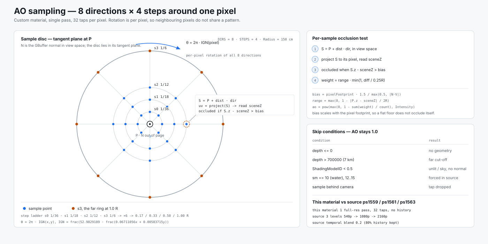

# 屏幕空间环境光遮蔽（Screen-Space AO）

> 结论先行：源帧的 AO 是**屏幕空间法线半球 raymarch，8 方向 × 4 步**，跑在三级金字塔上（540p → 1080p → 4K）并做时域累积。本项目在 UE 后处理材质里实现的是**单 Pass 近似**：同样的方向数、步数与步长梯度，用逐像素旋转噪声替代多 Pass，噪声交给 TAA（Temporal Anti-Aliasing）。数学正确性已用 CPU 参考实现逐像素验证（平均误差 0.0003–0.0011），但**真实视口下的观感尚未验收**。

## 状态

| 项 | 状态 |
| --- | --- |
| 源证据 | 完成：方向数、步数、步长梯度、半径/强度、跳过条件、三级与时域 |
| UE 落地 | 完成：`M_PP_CustomAO`（Before Bloom）、CPU 参考、合成场景单测、测试材质 |
| 数值验证 | 完成：单测 7/7；GPU vs CPU 平均 0.0003–0.0011，最大 0.010–0.042 |
| 残余 | 单 Pass、无金字塔/时域；半径未做单位换算；视口观感未验证 |

## 源证据

**采样结构** [事实]

- **8 个方向 × 4 步**，在法线半球内推进；方向由一张 64² 的旋转噪声图逐像素打散。
- 步长梯度为 `1/36 · 1/18 · 1/12 · 1/6`（相对量纲），近处密、远处疏。
- 半径参数 `cb0[28].x = 15`，强度 `cb0[29].x = 4`；遮挡累积后做 `pow(1 − ao, cb0[27].x)` 的 gamma 校正。
- 跳过条件：shading model ∈ {12,13,14,15} 或 `sm == 10`（水面）时 **AO 强制为 1**；视深 `viewZ > 700000`（7 km）同样输出 1。

**三级 + 时域** [事实]

| 级 | 分辨率 | 做法 |
| --- | --- | --- |
| 1 | 540p | 第一轮 raymarch，输出 540p AO |
| 2 | 1080p | 读 540p 结果作为起点，再做一轮 raymarch |
| 3 | 4K | 读 1080p 结果，第三轮 raymarch + 时域混合；`ao = lerp(prev, new, 0.2)`，即 80% 历史 |

金字塔的意义是把采样预算摊到多帧/多分辨率上，用历史帧换噪声。单 Pass 材质既拿不到上一帧缓冲，也不能在低分辨率上单独运行，这是载体决定的边界。

## UE 实现

**`M_PP_CustomAO`**（Post Process，Before Bloom，默认 `Enable_Custom_AO = 0`）：读 `SceneDepth` 与 `WorldNormal`，从深度重建视空间位置，按下面的核心逻辑求 AO：

```hlsl
float2 tanHalf = float2(1.0 / ResolvedView.ViewToClip[0][0],
                        1.0 / ResolvedView.ViewToClip[1][1]);
float3 P = float3(ndc0 * tanHalf * d0, d0);   // ndc0 由像素坐标换算
float3 N = normalize(mul(WorldNormal, (float3x3)ResolvedView.TranslatedWorldToView));

for (i = 0; i < 8; i++) {
    float a = rot + i / 8 * 2π;                 // rot = IGN(pixel) * 2π
    float tilt = 0.35 + 0.65 * (i & 1);         // 交替低/高仰角
    dir = normalize(tangent(a) * (1 - tilt*0.5) + N * (tilt*0.5));  // tangent 为切平面方向
    for (s = 0; s < 4; s++) {
        float3 S = P + dir * Radius * STEP_FRAC[s];   // {1/6, 1/3, 1/2, 1}
        float footprint = S.z * 2 * tanHalf.y / viewportH;
        float bias = footprint * 1.5 / max(0.5, abs(dot(N, normalize(P))));
        float diff = S.z - sceneDepthAt(S);
        if (diff > bias)
            occl += rangeFalloff * min(1, diff / (0.25 * Radius));
    }
}
ao = pow(max(0, 1 - occl / count), Intensity);
```

- **旋转噪声**：用 interleaved gradient noise（IGN）哈希，按像素坐标生成，不依赖纹理；源帧用的是 64² RG8 噪声图，这里没有复刻那张图。
- **偏置按像素足迹算**：`z·2·tanHalf/height`，再除以 `|N·V|`（下限 0.5）。这是为了解决「采样点取整到像素格后读到的是邻近曲面深度」的问题——掠射角平地上每像素深度变化很大，偏置必须跟着像素足迹走，而不是跟着 AO 半径走。
- **开关与调试**：MPC 参数 `AO_Radius`（默认 150 cm）、`AO_Intensity`（默认 1）、`AO_Debug_View`（1 时输出灰度 AO）。材质输出 `SceneColor × lerp(1, ao, Enable)`，`Enable=0` 时逐像素等于原图。
- **CPU 参考**：`ao_ref.mjs` 是算法的唯一来源，HLSL 是它的逐行转写；`ao_test.mjs` 用解析平面/球体构造已知答案，先验数学再去 GPU。



## 验证

| 项 | 方法 | 结果 |
| --- | --- | --- |
| 算法正确性 | `ao_test.mjs`：平地、内凹角、悬空球、天空、7 km、强度、半径 | 7/7 通过 |
| HLSL = 参考 | 测试材质渲到 160×90 RT，`ao_gpu_compare.mjs` 逐像素比对（半径 100/300，强度 1/4） | 平均 0.0003–0.0011，最大 0.010–0.042，误差 > 0.05 的像素 0 个 |
| 编译 | PS 统计 | 228 条指令，Custom 代码确实编入 |
| 真实场景观感 | 视口开 `Enable_Custom_AO = 1` | **未验证** |

GPU 测试使用的是解析平面场景（深度/法线由射线求交给出），验证的是**数学**。`M_PP_CustomAO` 里读 GBuffer 深度/法线、`TranslatedWorldToView` 的方向约定、世界法线到视空间的转换，这些只能在真实视口里验证。尤其 `mul(N, (float3x3)TranslatedWorldToView)` 这一行，如果 AO 在斜面上方向不对，应优先检查它。

## 与源的差异

1. **单 Pass vs 三级金字塔**：没有 540p/1080p/4K 三轮，也没有 `lerp(prev, new, 0.2)` 的时域累积。用逐像素旋转在单帧内打散噪声，稳定性依赖 UE 自带 TAA。
2. **噪声不是源帧那张图**：源帧是 64² 旋转噪声纹理，这里是 IGN 哈希，无纹理依赖。分布特性接近，但不是同一组数。
3. **半径没有单位换算**：源的 `15` 是它自己的相机/缩放空间；UE 侧 `150 cm` 只是世界单位的起步值，两者不能直接对等。半径的绝对值只影响遮蔽范围，不影响算法结构。
4. **偏置是额外设计**：按像素足迹的偏置没有源证据，是为了解决自遮挡问题引入的。源的偏置细节没有逐项解出。
5. **方向仰角与衰减函数是设计选择**：`0.35 / 1.0` 交替仰角、`rangeFalloff`（遮挡体远离半径时衰减到 0）都不是源数据，只有「8 方向 × 4 步 + 步长梯度 + 旋转噪声」有证据。
6. **材质 ID 跳过条件不同**：源帧跳过 `sm ∈ {10,12,13,14,15}`；UE 侧 shading model ID 体系不同，只跳过没有 GBuffer 法线的像素（unlit/sky）与 7 km 外。水面是否排除留到水面模块处理，没有在这里硬套源 ID。
7. **不是 1:1**：目标是结构一致、遮挡位置一致；边缘精度和噪声形态受单 Pass 限制。

## 相关文件

- 图示：`./images/diagrams/ao-sampling.svg`（8 方向 × 4 步半球采样）
- HLSL：`../hlsl/pp_custom_ao.hlsl`（`M_PP_CustomAO` 的 Custom 节点）
- CPU 参考 / 单测：`../tools/analysis/ao_ref.mjs`、`../tools/analysis/ao_test.mjs`
- 相关模块：`./sh-skylight.md`（同为 Before Bloom 的后处理项）、`./water.md`（水面 AO 跳过策略）
