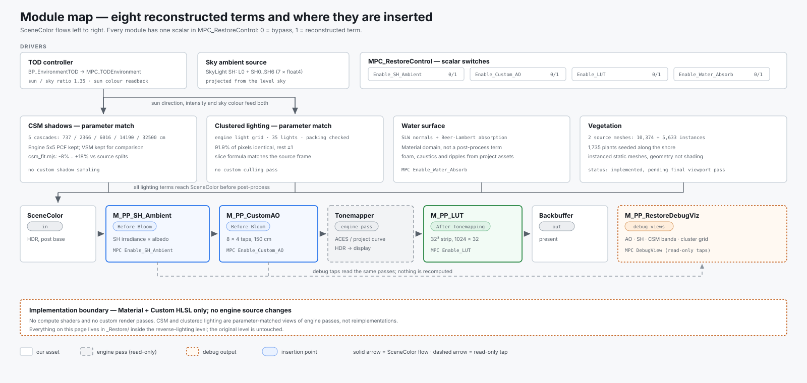
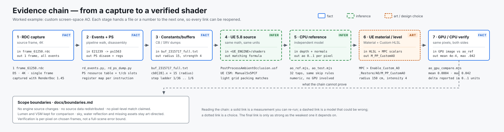
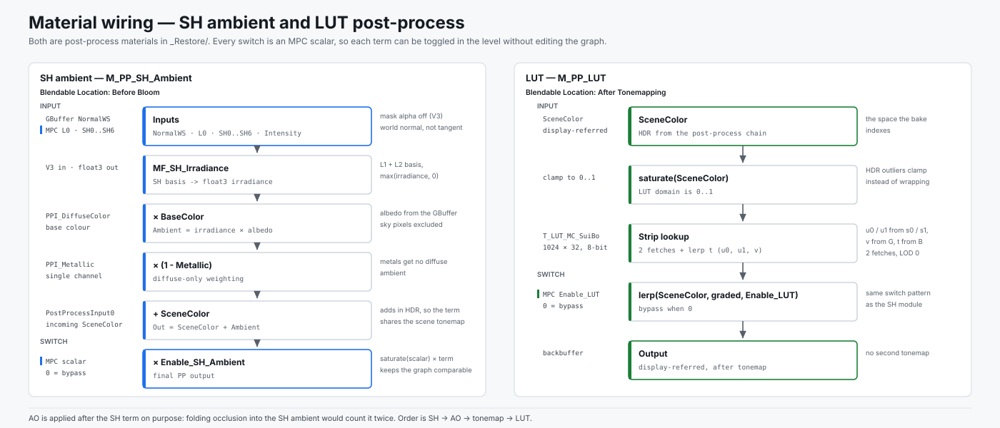

# 架构：从截帧证据到 UE 光照

> 目标：给定《鸣潮》(Wuthering Waves) 一个场景帧的 RenderDoc 截帧，在 Unreal Engine 5.8 中重建该帧的主光照结构与关键参数，并以可开关的方式逐模块验证。
> 本文说明项目的范围、证据链、模块划分与落地方式。各模块细节见同目录下的专题文档。

## 1. 项目目标与边界

**目标**：还原「水岸高塔」场景的日间光照——包括天光、局部灯、阴影、水面、色调映射与植被地表——并让每一项都能与原生 UE 实现并排对照。判定标准是结构与参数一致，不是像素级一致。

**范围**：L1 结构 + L2 四模块。L1 指渲染阶段与数据布局的对应关系；L2 指天光（SH）、环境光遮蔽（AO）、3D LUT、水体吸收四个可以完整自研的环节。CSM（级联阴影，Cascaded Shadow Maps）、聚簇光照（clustered lighting）、水面着色属于参数对齐，不是重写。

**载体边界**：全部实现落在 Material + Custom Node 上，不写 C++、不写 Global Shader。这直接决定了哪些环节能自研：球谐求值、全屏 raymarch AO、3D LUT 烘焙、Beer-Lambert 吸收可以做；聚簇剔除是 compute shader、shadow map 不被 UE 暴露，只能做参数对照与可视化。

**资产边界**：所有还原改动只落在复制出来的还原关卡与其独立目录内，原场景关卡与工程其余部分不动；不修改引擎源码，只读查证。

## 2. 源帧与采样

截帧集为同一街景的 8 个机位，每帧 RDC 约 1.6–2.1 GB，3840×2160，D3D11。[事实]

| 项 | 内容 |
| --- | --- |
| 主分析帧 | Frame 61250（面向高塔，水岸） |
| 交叉验证帧 | Frame 36153（补拍草坪） |
| 单帧规模 | 2302 Draw / 53 Dispatch / 939 张纹理 / 172 个自动切分 Pass |
| 切分方式 | 发布版无 marker，按「输出 RT 组合变化」自动切 Pass，编号是本项目的标签 |

主帧只渲染了 2 级 CSM（其余槽位是上一帧残留），灯数为 35 盏。

## 3. 13 阶段渲染链到 UE 的映射

| 鸣潮阶段 | 内容 | UE 对应 | 本项目动作 |
| --- | --- | --- | --- |
| A–B 准备/计算 | 帧前小目标、粒子更新 | 引擎内部 | 忽略 |
| C 预深度 | 选择性 depth prepass | EarlyZPass | 参数对照 |
| D 天空环境 | 天空 cube 逐 mip 合成 | SkyLight / SkyAtmosphere | 交给现有的天空系统承接 |
| E–F 几何/GBuffer | 7-MRT 写入 | Deferred GBuffer | 结构对照 |
| G 遮挡查询 | 包围体可见性 | 引擎内部 | 忽略 |
| H 阴影 | CSM + 局部光阴影 | CSM | 参数对齐（§CSM） |
| I 屏幕空间 | 贴花 + AO 链 | Decal + GTAO | 自研 AO 接入 |
| J 体积/GI | 半透明光照体积 + froxel | Volumetric Fog | 不做（源帧自身也未消费） |
| K 光照合成 | 聚簇延迟 + 太阳 + IBL + 雾 | Light Grid + SkyLight + SSR | SH 求值 + 聚簇对照 |
| L 后处理 | Bloom / DOF / TAA / 曝光 | UE 后处理栈 | 参数对齐 |
| M 终合成 | 32³ LUT 调色 | Color Grading LUT | 自研 LUT |

结论：UE 已覆盖 A–L 的骨架，需要长出鸣潮特有内容的只有四处——天空（D）、AO（I）、光照（K）、LUT（M）——外加水面与 TOD（Time of Day，时段）两个横切模块。

## 4. 证据链

每个模块都走同一条链，避免「看着像」替代可核验的结论：

1. **截帧**：RenderDoc 打开 RDC，定位到具体 event / pixel shader。
2. **数值**：导出该 event 的常量缓冲、结构化缓冲、RT，取得实值（颜色、方向、系数、尺寸）。
3. **源码对照**：在 UE 5.8 源码中找同名算法与常数，判断这是「UE 原生行为」还是「鸣潮自改」。
4. **CPU 参考**：用独立脚本按 shader 逐行复刻核心数学，可离线单测。
5. **UE 材质**：Custom Node 承载同一段数学，输入来自 GBuffer 与 MPC。
6. **验证**：GPU 渲染到 RT 后回读，与 CPU 参考逐像素比对；视觉部分再用真实视口截图确认。

第 3 步是整条链的关键。它把「猜鸣潮用了什么」变成了「确认鸣潮用的是 UE 的哪一段」，也决定了后面每个模块是自研还是参数对齐。

## 5. 鸣潮是 UE4 系渲染器

不是风格相似，而是逐项对得上 UE 源码（`Engine/Shaders` 与 `Engine/Source`）。这张判定表改变了整个还原策略：CSM、聚簇、水面不需要「近似替代」。[事实]

| 维度 | 鸣潮侧观察 | UE 源码侧 | 结论 |
| --- | --- | --- | --- |
| 聚簇切片 | 深度切片 `log2(z·B+O)·S`，S=4.05、B=0.00432649、O=0.915633，反解 near=10 cm | `GetLightGridZParams`，`DepthDistributionScale = 4.05f`，近裁面 10 cm | 同公式同常数 |
| 聚簇布局 | 60×34×32 簇、64 px 瓦片、每簇 32 灯槽 | `LightGridPixelSize=64`、`LightGridSizeZ=32`、`MaxCulledLightsPerCell=32` | 全部是 UE 默认值 |
| 灯数据打包 | 强度缩放 `1/Length`、10:10:10 打包颜色、点光哨兵值 (-2,1) | `PackLightColor`、`PackedPreProcAngleAndFlags` | 同一数据结构 |
| CSM 滤波 | 5×5 PCF，9 次 gather4，2040² 槽位（2048−2×4） | `Manual5x5PCF`、`SHADOW_BORDER=4` | 逐行对应 |
| 水面 | shading model ID=10，Schlick 相位 `1.55g−0.55g³`，`(1−T)·σs/σt`，`exp(−σt·d)` | `SHADINGMODELID_SINGLELAYERWATER`、`SchlickPhase`、SingleLayerWater | 就是 UE 的单层水体 |

因此：**CSM、聚簇、水面是对同一算法的参数对齐，不是另写一套。** 反过来，SH、AO、LUT、水体吸收这些 UE 以固定方式实现或不暴露中间结果的环节，才是本项目真正自研的部分。

## 6. 八模块矩阵

| 模块 | 证据 | UE 载体 | 自研程度 | 验证 | 状态 |
| --- | --- | --- | --- | --- | --- |
| SH 天光 | 7 个 float4，标准 SH 求值 [事实] | `MF_SH_Irradiance` + `M_PP_SH_Ambient` | 完整求值 + 天空自投影 | 调试球方向梯度；立体角积分误差 0.01%；视口确认 | 完成（与 SkyLight 的叠加关系待定） |
| LUT | 32³，五步烘焙 [事实] | `T_LUT_MC_SuiBo` + `M_PP_LUT` | 离线烘焙 + 手写三线性查表 | GPU 查表 vs CPU 最大误差 0.7–1.0/255 | 完成 |
| AO | 8 方向 × 4 步，三级 + 时域 [事实] | `M_PP_CustomAO` + CPU 参考 | 单 Pass 近似 | 7/7 单测；GPU vs CPU 平均 0.0003–0.0011 | 完成 |
| CSM | 5 级、2040² 槽、5×5 PCF [事实] | 引擎 CSM（三模式切换） | 参数对齐 | 三模式并排 + 级联色带 | 完成 |
| 聚簇 | 35 灯、60×34×32 [事实] | UE Light Grid + 35 盏源灯 | 参数对齐 + CPU 复刻剔除 | 逐像素 91.9% 完全一致，其余 ±1 | 完成 |
| 水面 | SLW 系数、g=0.5 [事实] | `MI_Water_Restore_SLW` | 填系数 + 少量美术项 | 编译、开关响应、同机位观感 | 完成 |
| TOD | 太阳色/方向/角半径、太阳:天光=1.35 [事实] | `CT_Restore_TOD` + 灯与雾 | 映射 + 大气透射率反算 | 地面太阳色回读一致 | 完成（仅 14.5 时一列有证据） |
| 植被 | 两种源网格、UV 段、实例分布 [事实] | `SM_WWGrass_TriCard_A/B` + `MI_WWGrass` | 源网格 + 程序化分布 | 有草/无草差分统计 | 完成（分布为近似） |

各项残余差距集中写在 [boundaries.md](./boundaries.md)，不在此重复。

## 7. 控制面：MPC 与 PPV 栈

**全局开关**：一个材质参数集合（Material Parameter Collection, MPC）承载 SH / AO / LUT 的开关与共享系数——`Enable_SH_Ambient`、`Enable_Custom_AO`、`Enable_LUT`、`SH_Debug_View`、`SH_Intensity`、`L0` 与 `SH0..SH6`，另有 AO 半径/强度与级联调试用的标量。水面因“一个材质最多引用 2 个 MPC”的限制，开关放在材质实例参数上，并镜像到 MPC 的 `Enable_Water_Absorb` 供脚本查询。约定：`Enable_*` 为 0 时材质直接返回输入颜色，保证「关」等于原生画面。

**后处理体积（Post Process Volume, PPV）栈**（按渲染阶段排序，不是 PPV 列表索引）：

| 顺序 | 材质 | 插入点 | 作用 |
| --- | --- | --- | --- |
| 1 | `M_PP_SH_Ambient` | Before Bloom | SH 环境光叠加 |
| 2 | `M_PP_CustomAO` | Before Bloom | 屏幕空间 AO，乘在不透明表面 |
| 3 | `M_PP_LUT` | After Tonemapping | 32³ 调色查表 |
| 4 | `M_PP_RestoreDebugViz` | After Tonemapping | 级联色带 / 聚簇瓦片调试 |

SH 与 AO 放在 Bloom 之前，是为了让后续的 Bloom 与曝光看到它们的结果；先叠加 SH、再乘 AO，AO 会同时作用在场景色与 SH 补光上。LUT 放在 Tonemapping 之后，与 UE 色彩分级的位置一致，也避免与引擎 tonemapper 二次压缩。调试材质独立成一件，不往生产材质里塞探针。

## 8. 关卡与资产布局

还原在一个复制出来的关卡上进行，所有新增内容集中在独立的还原目录，原场景关卡与工程其余部分不动。

| 目录 | 内容 |
| --- | --- |
| `_Restore/Common` | MPC_RestoreControl、共享材质函数 |
| `_Restore/SH` | `MF_SH_Irradiance`、`M_PP_SH_Ambient`、调试球材质 |
| `_Restore/AO` | `M_PP_CustomAO`、测试材质 |
| `_Restore/LUT` | 32³ LUT 贴图、`M_PP_LUT`、测试材质 |
| `_Restore/Water` | 水面材质实例（基于工程既有的单层水体材质） |
| `_Restore/Sky` | 体积云材质实例 |
| `_Restore/Veg` | 两种草网格与材质实例 |
| `_Restore/TOD` | 时段曲线资产 |

关卡内另有 PPV 宿主、SH 调试球，以及 35 盏源灯（独立 Outliner 文件夹）与水面/植被的组件级覆盖。还原目录下 21 个自研材质、网格与 MPC 合计约 600 KB；仓库不收录 `.uasset/.umap`，也不收录 LUT 条带、灯数据、草地实例等任何游戏派生数据，只保留统计数字与截图。

## 9. 设计决定

| 决定 | 选择 | 理由 |
| --- | --- | --- |
| 全局光照 | 保留 Lumen 做对照 | 自研模块用独立开关叠加，可随时与原生 GI 并排；不破坏现有画面 |
| 阴影 | 保留 VSM 做基线，CSM 做对照 | 运行时切换阴影模式，三种状态同机位对比 |
| 实现载体 | Material + Custom Node | 不写 C++、不写 Global Shader；代价是聚簇与 shadow map 无法自研 |
| Substrate | 关闭 | 全工程材质均未使用 Substrate 节点，属于空开关 |
| 引擎源码 | 只读，不修改 | 所有对照基于公开发布的 5.8 源码，结论可复现 |
| 原场景 | 不修改 | 还原内容全部在新的关卡副本与独立目录内 |

这些决定共同界定了本项目的能力上限：**四个可自研模块做到可验证的完整实现；其余模块按各自证据强度做参数对齐或数据重建，并写明近似从哪里开始。**
