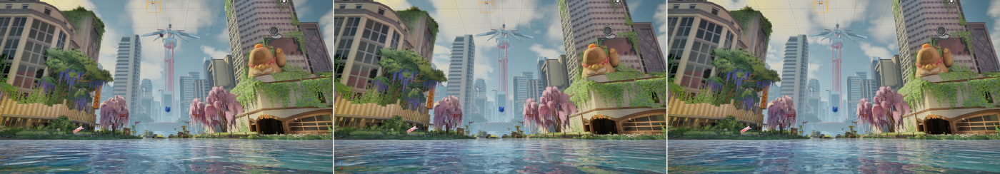
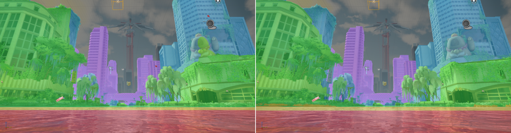

# 级联阴影对齐（Cascaded Shadow Maps, CSM）

> 结论先行：源帧的渲染器是 **UE4 系**——5 级级联、5×5 PCF（Percentage-Closer Filtering）、每槽 2040² 都与 UE 的 `Manual5x5PCF` 和 `SHADOW_BORDER = 4` 逐项对得上。因此本项目**没有重写 CSM**，只在运行时切换 VSM（Virtual Shadow Maps）/ UE CSM / 对齐参数的 CSM 三种模式，把级联分布拟合到源帧的 5 个远平面。**这是参数对齐，不是阴影算法重写。**

## 状态

| 项 | 状态 |
| --- | --- |
| 源证据 | 完成：5 级远平面、图集/槽位、PCF 核、级联选择顺序、法线偏移 |
| UE 落地 | 完成：`vsm / csm_ue / csm_mc` 三模式运行时切换、级联色带可视化 |
| 验证 | 完成：切换生效、三模式同机位截图、色带对照；边界误差 −8%~+18% |
| 残余 | UE 单指数无法完全匹配源帧；本帧级联数、法线偏移、选择方式存在结构差异 |

## 源证据

**级联布局** [事实]

- **5 级**，远平面为 **800 / 2000 / 6500 / 15000 / 32500 cm**（依次由近到远）。
- 阴影图集 **10240 × 2048** = 5 个 2048 宽的列；每列可用区域 **2040²**，四周留 4 px 边界。`2048 − 2×4 = 2040` 正是 UE `ShadowSetup.cpp` 的 `SHADOW_BORDER = 4`。
- 本帧只重画了槽 0 与槽 1，槽 2–4 是上一帧残留——逐槽采样统计证明了这一点 [事实]。这不是「只有 2 级」；为何只更新 2 级是 [推断]：引擎按可见距离动态裁剪了需要更新的级联。
- 级联深度范围约为 82646 / 36261 / 16219 / 10000 / 10000（前三级随远平面缩放，后两级固定）。

**同源判定** [事实]：把源帧的三处实现与 UE 源码逐项对照——5×5 PCF 的 9 次 `gather4` 与 `Manual5x5PCF` 一致；每槽 2040 = 2048 − 2×`SHADOW_BORDER`；级联数、远平面与深度范围的组合方式符合 UE 的级联配置语义（这一条是 [推断]，前两条是逐值命中）。三条独立证据同时成立，才把「鸣潮是 UE4 系渲染器」作为后续所有对齐工作的前提，而不是仅凭画面相似。

**PCF 核** [事实]：5×5 共 25 个采样点，用 **9 次 `gather4`**（每次取 4 个纹素）实现，偏移为 ±2 纹素；比较结果 `> 0.99` 时视为完全照亮。这与 UE `ShadowFilteringCommon.ush` 的 `Manual5x5PCF`（`r.ShadowQuality ≥ 4` 时启用）逐行一致。

**级联选择与偏置** [事实]

- 选择从**最远**级联往前遍历：`(viewZ − split[i]) / range[i] < 1` 时命中该级；全部不中则 `discard`。
- 法线偏移：`saturate(N·L · k + k) · bias`，越背光偏移越大，用于抑制自阴影。
- 输出是屏幕空间阴影遮罩，后续光照 Pass 按需采样；主光照 Pass 本身不读 shadow map。

## UE 实现

`ue_csm_mode.py` 在运行时改太阳属性与 cvar，不改 ini、不重启：

| 模式 | VSM | 级联 | 分布指数 e | 阴影距离 | 其它 |
| --- | --- | --- | --- | --- | --- |
| `vsm`（基线） | 开 | 4 | 3.0 | 40000 × 0.85 | 关卡原值 |
| `csm_ue` | 关 | 4 | 3.0 | 40000 × 0.85 | UE 自己的 CSM |
| `csm_mc` | 关 | **5** | **2.24** | **32500**（DistanceScale = 1） | MaxCSMResolution 2048、ShadowQuality 5 |

UE 的级联边界是一段几何级数：

```
split(i) = Near + (Σ_{k<i} e^k / Σ_{k<N} e^k) · (R − Near)      Near = 10 cm
```

取 `N = 5, e = 2.24, R = 32500` 得到 **737 / 2366 / 6016 / 14190 / 32500 cm**，对源帧的误差为 **−8% / +18% / −7% / −5% / 0%**。误差无法归零的原因很直接：源帧相邻级联的倍率是 **2.50 / 3.25 / 2.31 / 2.17**，不是常数，而 UE 只有一个分布指数，拟合自由度和源帧的硬编码数组不对等。





**关于另一组 5 级结果**：`csm_fit.mjs` 还会搜索 UE 的「近级联 + 远级联」布局（`FarShadowCascadeCount`），最优的 4 + 1 结果是指数 2.3、DynamicShadowDistance 14800、FarShadowDistance 32500，得到 **723 / 2361 / 6131 / 14800 / 32500**（误差 −10% / +18% / −6% / −1% / 0%，对数域 RMS 0.091）。**关卡实际使用的是上表的 5 个普通 dynamic cascades，即 737/2366/6016/14190/32500；README 只引用这一组。** 4+1 far 是脚本探索的另一种 UE 特性，没有应用到关卡，两者的参数语义和适用场景不同，不能混用。

**可视化**：后处理材质 `M_PP_RestoreDebugViz`（After Tonemapping）按深度着色级联色带，模式 1 画源帧级联、模式 2 画当前 UE 级联；切模式时会把 UE 的实际指数/距离/级联数写进 MPC。

## 验证

| 项 | 结果 |
| --- | --- |
| 运行时切换 | 通过：`r.Shadow.Virtual.Enable 0/1` 不重启即生效，三种模式截图有可见差异 |
| 级联边界 | 通过：色带叠加显示两组边界大体重合，差异集中在第 2 级（+18%） |
| 色带材质 | 通过：编译 146 条 PS 指令；视口对照两套色带 |
| 同机位观感 | 三种模式在中景差异很小；VSM 与两种 CSM 的软硬在不同截图路径下印象不一致，差异主要在级联边界位置 |

近景细枝边缘的软硬在不同截图路径下给出过不一致的印象，因此**不把「软硬」当作对齐指标**，只以级联边界位置与阴影覆盖范围为准。

## 与源的差异

1. **边界误差 −8%~+18%**：UE 用单一指数生成几何级数，源帧是硬编码的非等比数组，第 2 级偏差最大。这是参数模型的自由度差异，不是调参遗漏。
2. **本帧级联数不同**：源帧只更新 2 级，UE 每帧渲染全部级联。这是引擎的按需裁剪策略差异，画面在远处可能因此更稳定或更锐，不做逐帧对齐。
3. **法线偏移没有同名参数**：源帧的 `saturate(N·L·k+k)·bias` 在 UE 里不存在，UE 使用 depth/slope bias。两者都能抑制自阴影，但数值不可一一对应。
4. **级联选择方式不同**：源帧一次全屏 PS 循环从远到近选级联；UE 是逐级联投影 Pass 加过渡带（`CascadeTransitionFraction`）。因此级联交界处的过渡形态不同。
5. **PCF 核相同但采样布局不保证完全一致**：核函数、偏移步长、命中阈值都是同一套，但图集坐标、深度量化与边界处理由各自引擎决定。
6. **VSM 是基线对照**：VSM 与 CSM 不能同时开启，切换是运行时的 cvar 状态，重启编辑器后回到 ini 默认；太阳属性属于关卡，保存后保留。

## 相关文件

- 图示：`./images/csm-modes.png`（VSM / UE CSM / 对齐 CSM，均为 UE 画面）、`./images/csm-bands.png`（级联色带）
- 拟合工具：`../tools/analysis/csm_fit.mjs`（UE 公式、4 级拟合、5 级与 4+1 far 搜索）
- 模式切换：`../tools/ue/ue_csm_mode.py`
- 相关模块：`./clustered-lighting.md`（同为 UE4 系渲染器的参数对齐）、`./boundaries.md`（阴影的全局约束）
