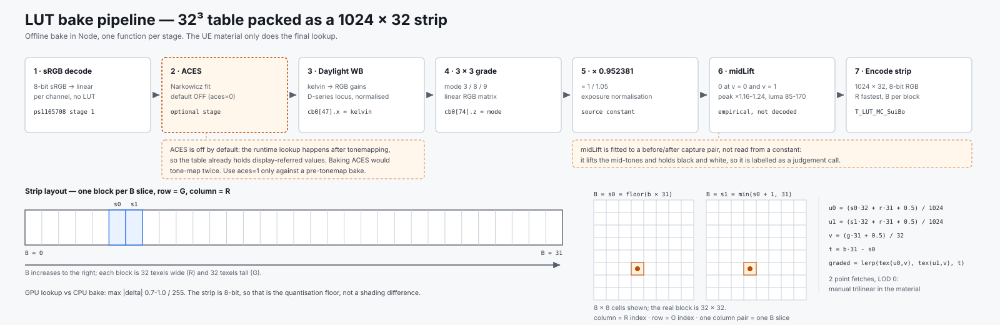

# 32³ LUT 调色（Color Grading LUT）

> 结论先行：源帧把 **sRGB 解码 → ACES（Academy Color Encoding System）风格曲线 → CIE 日光白平衡 → 3×3 分级 → ×0.952381** 五步烘焙进一张 32³ LUT，运行时只做一次三线性采样。本项目离线复现了这五步，输出 1024×32 条带交给 UE；GPU 查表与 CPU 参考的最大误差 **0.7–1.0/255**。**ACES 默认关闭**，因为 UE 的 After Tonemapping 位置已经在 tonemap 之后，再走一次 ACES 会二次压缩。

## 状态

| 项 | 状态 |
| --- | --- |
| 源证据 | 完成：五步烘焙顺序、色温/分级常数、32³ 格式、运行时单次采样 |
| UE 落地 | 完成：离线烘焙器、导入的 LUT 纹理、`M_PP_LUT` 手写三线性、测试材质 |
| 验证 | 完成：中性点、GPU vs CPU 逐像素、彩色自检；已进视口 |
| 残余 | ACES 关闭、分级矩阵未启用、`midLift` 是经验曲线；不是完整复刻 |

## 源证据

**烘焙与采样** [事实]：调色 LUT 由一个 32×32 视口、`inst=32` 的 Pass 生成，写入 32³ R10G10B10A2；最终合成 Pass 读同一张表，**一次三线性采样**后输出到 swapchain。LUT 里按顺序烘焙了：

1. **sRGB → 线性解码**：`0.012683 / 0.835938 / 18.6875 / 18.851563` 是 sRGB 精确逆变换的常数。
2. **ACES 风格 tonemap**：同一组常数也出现在拟合曲线的分子分母里，确认是 ACES 家族而不是普通 gamma。
3. **色温白平衡**：色温取自 `cb0[47].x`（开尔文）；`2967800 / 1901800 / 99.11 / 247.48 / 0.244063 / 0.237040` 是 CIE D 系列日光轨迹的多项式系数。
4. **色彩分级 3×3**：`cb0[74].z` 选择模式（代码里比较 3 / 8 / 9），模式 8/9 走一个接近 AP1→sRGB 的矩阵（`0.613191, 0.339512, 0.047366 / 0.070207, 0.916336, 0.013450 / 0.020619, 0.109567, 0.869607`）。
5. **×0.952381**（= 1/1.05）做整体曝光归一化。

**中调提亮的证据强度** [推断]：比较 LUT 前（运动模糊输出）与最终 swapchain 两张图，sRGB 均值约 ×1.15，提升集中在 luma 85–170（×1.16–1.24），暗部与高光基本不动（×1.02–1.11）。但这对帧之间还夹着 Bloom 与 FFT Bloom 合成，只能约束**整体显示变换的形状**，不能单独归因给 LUT。

## UE 实现

**离线烘焙**（`lut_bake.mjs`，纯 Node）：

```
for b, g, r in 32³:
    c = sRGB_to_linear(r,g,b)
    c = ACES(c)                 // 默认跳过，见「与源的差异」
    c = c × VonKriesGains(kelvin)
    c = AP1_to_sRGB(c)          // 仅 --grade-mode 8/9
    c = c × (1/1.05)
    out[b][g][r] = sRGB(c) + midLift
```

- **白平衡**：用 CIE D 系列轨迹由开尔文算白点（`x` 为分段多项式，`y = −3x² + 2.870x − 0.275`），再按 Von Kries 取参考白 / 目标白的逐通道增益，最后按绿通道归一化，保持整体曝光。6500 K 落在 D65（0.3128, 0.3292），增益退化为 (1, 1, 1)；低色温给出偏蓝补偿，高色温给出偏黄补偿。
- **`midLift`**：作用在 sRGB 编码值上，`v' = v + strength·6.75·v·(1−v)²`，两端为 0，只抬中调。这是对上面那张差分图的形状拟合，**不是解码出的源步骤** [推断]。当前烘焙参数为 `--kelvin 6500 --grade-mode 0 --aces 0 --lift 0.07`。
- **条带布局**：1024×32 PNG，**块 = B、行 = G、块内列 = R**。`M_PP_LUT` 按 `slice = b×31` 在相邻两层之间插值，`u = (slice×32 + r×31 + 0.5)/1024`、`v = (g×31 + 0.5)/32`，即手写三线性：

```hlsl
float3 c = saturate(SceneColor);
float bSlice = c.b * 31.0;
float s0 = floor(bSlice), s1 = min(s0 + 1.0, 31.0);
float u0 = (s0 * 32.0 + c.r * 31.0 + 0.5) / 1024.0;
float u1 = (s1 * 32.0 + c.r * 31.0 + 0.5) / 1024.0;
float v  = (c.g * 31.0 + 0.5) / 32.0;
float3 a = Texture2DSampleLevel(LUT, LUTSampler, float2(u0, v), 0).rgb;
float3 b = Texture2DSampleLevel(LUT, LUTSampler, float2(u1, v), 0).rgb;
float3 graded = lerp(a, b, bSlice - s0);
```

UE 自带的 Color Grading LUT 也是条带，但它的坐标推导封装在引擎里；这里手写是为了让索引顺序可见、可测，出问题时能逐行对照。

- **导入设置**：关 sRGB、无 mip、`Color Lookup Table` 组、Clamp。导入接口的 `lodGroup` 参数不生效，导入后要补设纹理组与无 mip。
- **测试材质** `M_Dbg_LUT_Test`：给一个解析渐变输入，把查表结果渲到 RenderTarget，用于脱离视口做 CPU/GPU 逐像素比对。
- **用材质而不是 PPV 的 Color Grading LUT 槽**：该槽已被工程原有的 Fuji LUT 占用，换掉会失去对比基线；材质还能读 `Enable_LUT`，与 SH / AO 用同一套开关。




## 验证

| 项 | 方法 | 结果 |
| --- | --- | --- |
| 白平衡方向 | 4000 / 5000 / 6500 / 8000 / 12000 K 的中灰 | 6500 K = (129,129,129)；低色温偏蓝补偿、高色温偏黄补偿，方向正确 |
| GPU 查表 = CPU | 测试材质渲到 RT，逐像素与 CPU 表比对（B = 0.1/0.5/0.9） | 最大误差 0.7–1.0 / 255 |
| RT 读回校准 | 直通模式对比已知输入 | 0.5 / 255（RT 格式不同，读回编码不同，必须先校准再比较） |
| 彩色自检 | 非灰输入 | (0.3,0.7,0.2) → (90,185,63)；(1,0.6,0.8) → (250,164,205) |
| 视口 | 编辑器内切 `Enable_LUT` | 已开启；绿植/樱花的颜色恢复正常 |

**一次 G/B 通道互换的排查**：最初的烘焙器把 B 当行、G 当块，而查表约定是块 = B、行 = G，于是 **G/B 被互换**。视口里的症状是绿植变紫、粉色樱花变黄。之所以早期验证没发现，是因为只测了灰阶输入（`g == b`），互换在灰阶上不可见。修复的是条带写入端的索引顺序，重烘、重导入后才闭环；随后补了上面的彩色自检，专门防止同类错误再次被灰阶掩盖。

## 与源的差异

1. **ACES 默认关**：源帧的 ACES 烘在 LUT 里、跑在 tonemap 之前；UE 的 After Tonemapping 材质在 tonemap 之后，再压一次会二次 tonemap。`--aces 1` 可以打开做实验，但不是默认。
2. **白平衡色温来源不同**：源帧的色温是场景驱动值；这里做成烘焙参数，便于 TOD 模块后续驱动。
3. **分级矩阵实现了但默认不启用**：模式 8/9 的 AP1→sRGB 矩阵在烘焙器里可用（`--grade-mode 8`），但本帧没有证据说明实际走哪个模式。
4. **`midLift` 不是解出的步骤**：它是根据前后帧差值拟合的中调曲线，且那对帧包含 Bloom，所以只能算显示变换的形状近似 [推断]，不是源 LUT 的第六步。
5. **应用位置不同导致不可完全对齐**：源帧把 tonemap、白平衡、分级全部装进 LUT；UE 的 tonemap 在 LUT 之前发生，只能复现「白平衡 + 分级 + 归一化」这一部分。**这是位置差异带来的硬边界，不是参数没调好。**
6. **不是 1:1**：LUT 的目标是对齐调色方向与中调响应，不追求逐像素一致。

## 相关文件

- 图示：`./images/lut-compare.png`（关 / 开 / 源帧同机位）、`./images/diagrams/lut-pipeline.svg`（五步烘焙与条带布局）
- HLSL：`../hlsl/pp_lut.hlsl`（`M_PP_LUT` 的三线性查表）
- 烘焙器：`../tools/analysis/lut_bake.mjs`
- 相关模块：`./tod.md`（色温与显示变换）、`./sh-skylight.md`（同为后处理栈中的独立开关）
