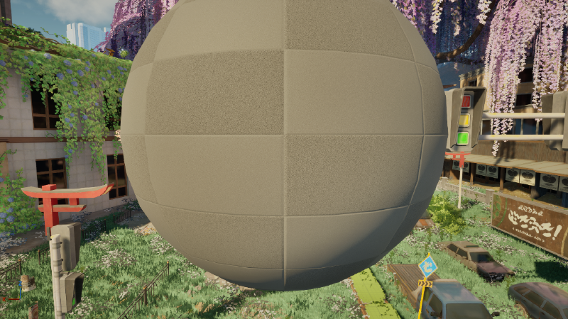

# SH 天光求值（Spherical Harmonics Sky Irradiance）

> 结论先行：源帧的天光漫反射是 **7 个 `float4` 的球谐系数**，L1 + L2 共 9 项。本项目在 UE 里完整实现了这套求值，并自己从场景天空做 6 面投影生成系数，立体角积分误差 0.01%。**求值、投影、接入三段代码都已完成；未完成的是「它和 SkyLight + Lumen 是什么关系」这个设计问题，而不是 shader。**

## 状态

| 项 | 状态 |
| --- | --- |
| 源证据 | 完成：7×`float4` 布局、L1+L2 求值顺序、L0 在 `.a` 的打包方式、UE 同源布局 |
| UE 落地 | 完成：`MF_SH_Irradiance`、`M_PP_SH_Ambient`、`M_Dbg_SH_Sphere`、6 面投影写 MPC |
| 验证 | 部分：立体角积分 0.01%、调试球梯度正常、编译通过；叠加增益仍在校准 |
| 残余 | SH 是叠加而非替代；强度/颜色与 SkyLight 的配比未定；specular 归属未定 |

## 源证据

**布局与求值** [事实]：`SkyIrradianceEnvironmentMap` 是一个 7 个 `float4` 的结构化缓冲，与 UE 的 `FSHVectorRGB3` 布局一致。IBL 合成 Pass 的指令 133–154 按下列顺序求值：

```
L1 = dot(SH[0..2], (nx, ny, nz, 1))
L2 = dot(SH[3..5], (ny·nz, nx·nz, nx·ny, 1))
L2 补充 = SH[6].xyz · (nx² − ny²)
irradiance = max(0, L1 + L2 + 补充)
```

- `SH[0..2]` 是 3 个 L1 项，`SH[3..5]` 是 L2 的交叉项，`SH[6]` 补上 `x² − y²`。常数项（DC）被塞进每个 `float4` 的 `.a` 通道。
- 同一 Pass 里还有一个分支：当 `cb0[268].w < 0.1` 时走上面的 SH 路径，否则退回 6 方向常数的加权和 [事实]。后者没有实现——本项目只做有系数的那条路径。
- 这组 SH 是该帧**天光漫反射的唯一来源**；镜面反射走反射探针数组 + 天空 cube，不走 SH [事实]。

**[推断] 系数数值没有导出**：逆向阶段只确认了布局，没有把结构化缓冲的 7 个 `float4` 数值带出来。因此本项目不从源帧取值，而是从还原场景的天空自行投影——得到的是**同一结构下的另一组系数**，不是原值。

## UE 实现

**`MF_SH_Irradiance`**（Material Function）：10 个输入（`NormalWS`、`L0`、`SH0..SH6`、`Intensity`）接一个 Custom 节点，输出 `Irradiance`：

```hlsl
float3 n = normalize(NormalWS);
float3 L1 = SH0.rgb * n.x + SH1.rgb * n.y + SH2.rgb * n.z;
float3 L2 = SH3.rgb * (n.y * n.z)
          + SH4.rgb * (n.x * n.z)
          + SH5.rgb * (n.x * n.y)
          + SH6.rgb * (n.x * n.x - n.y * n.y);
return max(float3(0, 0, 0), (L0 + L1 + L2) * Intensity);
```

**`M_PP_SH_Ambient`**（Post Process，Before Bloom）：读 `WorldNormal`（GBuffer）、`DiffuseColor`、`Metallic` 与 `PostProcessInput0`，按

```
ambient = irradiance × BaseColor × saturate(1 − Metallic)
out     = SceneColor + ambient × Enable_SH_Ambient
```

叠回画面。AO 有意不在这里乘——自定义 AO 模块随后会乘一次，折进来会重复遮蔽。**这里没有替代 SkyLight，也没有替代 Lumen，只是在已有间接光之上再加一份。**

**系数投影**（离线，`ue_sh_apply.py`）：

1. `SceneCapture2D` 放到场景高空（z = 60000 cm），水平朝 0°/180°/±90°、垂直朝 ±90°，各拍一张 64² 的 LDR 最终色。
2. 每个像素按立方体面方向求单位向量，用真实 SH 基（`0.282095`、`0.488603`、`1.092548`、`0.315392`、`0.546274`）加权积分；立体角权重为 `4/N² / (1+u²+v²)^1.5`。
3. 6 面 24,576 个样本的立体角总和为 12.5671，对 4π = 12.5664 误差 0.01%。
4. 按 `L0` + `SH0..SH6` 打包写进 `MPC_RestoreControl`。L0 作为**独立 `float3`** 传入，R/G/B 保留各自的 DC 项——源帧的三个 `.a` 相加后仍是一个标量，只能广播到三通道，这是有意保留的差异。

**调试球** `M_Dbg_SH_Sphere`：Unlit Surface，`WorldNormal → SH → Emissive`，用于脱离后处理栈检查求值方向。它使用材质本地的 `SH_Intensity`（默认 1），**不读 MPC 的 `SH_Intensity`**；MPC 的 `SH_Debug_View` 也没有被任何材质引用，属于预留未接线。



## 验证

| 项 | 结果 |
| --- | --- |
| 投影正确性 | 通过：立体角总和 12.5671 vs 4π，误差 0.01% |
| 求值方向 | 通过：调试球顶亮底暗，冷蓝色与场景天空一致 |
| 编译 | 通过：PCD3D_SM6 |
| 叠加响应 | 已定量、未定论：SkyLight 1.2 + `SH_Intensity=1` 时广场 luma +39%~55%，饱和度 0.28 → 0.16~0.22；`=2` 时 +50%~67%，不是可用状态 |
| 单独 SH | SkyLight 关时，`SH_Intensity=0.1` 中/低亮度区比基线亮 4%/9%，`0.2` 时 10%/14%；要大致等于 SkyLight 的环境贡献约需 **0.05–0.1**，但颜色偏绿 |
| 加法模式 | SkyLight 开时，`0.1` 已带来 +7%~16% 亮度并明显去饱和；「轻微补光」应取 **0.02–0.05** [美术] |

一次性 `SceneCapture` 截图在 `capture_every_frame=False` 时会跳过后处理材质 blendable，因此 SH 开关的对比必须用真实视口截图；早期基于一次性截图的「87% 像素变化」结论已作废。

## 与源的差异

1. **L0 的载体不同**：源帧塞在 `float4.a`（标量广播），这里用独立 `float3`，DC 项可以带颜色。求值公式其余部分一致。
2. **系数来源不同**：源帧的 7×`float4` 没有导出；这里从 LDR 屏幕缓冲的天空捕获重新投影，系数是相对值（DC 是 1 的量级，而真实辐照度要比它大几个数量级）。`SH_Intensity` 承担这个尺度换算，raw 系数保持可读但不是物理量。
3. **只做 SH，不做 6 方向 fallback**：源帧在 `cb0[268].w ≥ 0.1` 时走 6 方向近似，本项目未实现该分支。
4. **叠加而非替代**：源帧里 SH 是天光漫反射的唯一来源；UE 关卡里 SkyLight 与 Lumen 已经在提供间接光，SH 是第二份。这是设计层面的差异，也是目前增益必须压到 0.02–0.1 的原因。
5. **specular 没有对应**：源帧的 SH 只进漫反射；本项目同样只加漫反射，金属和镜面仍由 UE 的天光/反射系统负责。
6. **调试视图未闭环**：`SH_Debug_View` 未接线，调试球的缩放是材质本地参数，不能从 MPC 统一调。

## 相关文件

- 图示：`./images/sh-debug-sphere.png`（调试球方向梯度）
- HLSL：`../hlsl/sh_irradiance.hlsl`（Material Function 求值体）、`../hlsl/pp_sh_ambient.hlsl`（后处理叠加）
- 投影与写 MPC：`../tools/ue/ue_sh_apply.py`
- 相关模块：`./tod.md`（换天空后需要重投影）、`./ambient-occlusion.md`（AO 与 SH 的先后关系）
