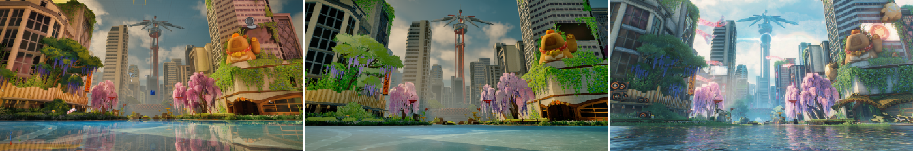

# 工具链：编辑器自动化、截图与数值验证

> 这条工具链解决三个问题：在不开编辑器 UI 的前提下批量改 UE 资产；拿到能代表最终画面的截图；把 shader 数学变成可逐像素比对的数字。三者缺一不可——只做前两项会得到「看起来对」的结论，只做第三项则无法判断真实画面。

## 1. 三层结构

| 层 | 位置 | 依赖 | 用途 |
| --- | --- | --- | --- |
| 编辑器自动化 | `tools/ue/` | UE 5.8 + UE_MCP_Bridge | 建材质、改 MPC/PPV、放灯、切阴影模式、截图 |
| 独立数值分析 | `tools/analysis/` | 纯 Node（部分需源数据） | CPU 参考实现、拟合、GPU/CPU 对比、统计 |
| 图像处理 | `tools/image/` | 纯 Node，零外部依赖 | PNG 缩放、并排、差分、裁剪、分带统计 |

RenderDoc 批处理（`tools/renderdoc/`）负责把证据从 RDC 里取出来，是整条链的入口。

## 2. UE 编辑器自动化

**桥接**：UE_MCP_Bridge 以 WebSocket 暴露编辑器能力，监听端口由桥接写入工程的 `Saved` 目录，每次启动可能变化，所以不硬编码。`tools/ue/ue.mjs` 是一个薄客户端：

```bash
node tools/ue/ue.mjs <method> '<json>'
```

它不做业务逻辑，只负责读端口、连接、发请求、回显结果。全量约 1079 个 action，实际使用集中在 `run_python_file`、`set_property`、`get_statistics` 与材质表达式相关接口。方法名与参数通过 `get_bridge_capabilities` 自查，不依赖文档记忆。

**跑编辑器 Python**：`tools/ue/py.sh <script.py> [args...]` 封装 `run_python_file`，约定脚本暴露 `run(*args)`。两个细节：参数一律以字符串传入，脚本内自行 `int()` / `float()`；Git Bash 会把形如 `/Game/...` 的参数改写成 Windows 路径，脚本必须设置 `MSYS_NO_PATHCONV=1` 再转发。

**为什么不用命令行 Python**：离线环境没有可直接调用的 Python，数值工具全部用 Node 写；编辑器内的 Python 只做引擎 API 调用，不承担计算。

## 3. 截图：真实视口 vs SceneCapture

这是本项目最重要的一条工程结论：**只有真实视口截图能代表最终画面。**

| 维度 | 视口截图（`vpshot.sh`） | SceneCapture 一次性截图 |
| --- | --- | --- |
| 后处理材质 | 正常参与 | `capture_every_frame=False` 时被跳过 |
| 曝光 | 与编辑器一致，手动曝光可控 | 走另一套路径，直方图自动曝光可能被上限钳住 |
| Lumen 反射 | 有场景缓存，反射正常 | 一次性截图没有场景缓存，水面/金属只剩天空 |
| TAA | 历史稳定，画面收敛 | 同状态连拍两次也有约三到四成像素差异 |
| 输出 | 带编辑器图标，FOV 为视口的 90° | 可指定相机与 FOV，但不代表视口 |

`vpshot.sh` 的做法是：临时把视口相机挪到目标机位 → 触发 `HighResShot` → 还原相机。前提是关闭编辑器的后台节流（`bThrottleCPUWhenNotForeground=false`，只存内存，重启失效），并在截图前把最小化窗口还原——窗口最小化时视口不渲染，截图请求会一直排队。

调试期的对照图统一按「关 / 开 / 源帧同机位」三张一组，机位由源帧相机 JSON 换算到关卡坐标。少数补拍帧需要额外加一个固定偏移才能对齐构图。



代码：[ue.mjs](../tools/ue/ue.mjs)、[vpshot.sh](../tools/ue/vpshot.sh)。

## 4. RenderDoc 批处理

`qrenderdoc --python` 以无界面方式打开 RDC，按脚本导出事件表、常量缓冲、shader 反汇编、指定 RT 与像素探针。批处理的目的是把「打开 UI 肉眼找」变成「可 grep 的文本」：事件按输出 RT 组合自动切分 Pass；常量缓冲按 event 导出快照；RT 导出成 PNG 供后续图像统计。

导出物固定为四类，命名带 event 与资源 ID，便于回溯：

| 类型 | 内容 | 用途 |
| --- | --- | --- |
| 事件表 | draw/dispatch、读写资源、渲染状态 | 切 Pass、定位光照与阴影事件 |
| 常量快照 | 每个 event 的 cb0–cb4 实值 | 取太阳、雾、水面、灯的参数 |
| shader 反汇编 | 目标 PS/CS 的指令文本 | 提炼公式与常数，不复制原文 |
| RT / 探针 | 指定纹理导出、逐像素读值 | 判断写什么、验证推断 |

注意两点：整数常量在反汇编里常以反规格化浮点显示，需按 uint 位型解读；常量快照只对首次导出时刻有效，换 event 必须重新导出。

## 5. 图像与数值验证

**PNG 工具**：`tools/image/png.mjs` 用纯 Node 完成读写、缩放、并排、差分、裁剪，不依赖 ImageMagick / Pillow。所有对外图片都用它重编码，顺带去掉元数据、裁掉编辑器顶部 UI。分带统计（天空/中景/水面）也在这层完成，作为调参的客观依据。

代码：[png.mjs](../tools/image/png.mjs)。

**CPU 参考 → HLSL → GPU 回读**：以 AO 为例，`ao_ref.mjs` 是算法的唯一来源，HLSL 是它的逐行转写。验证路径是：把同一段数学渲染到 RenderTarget，回读像素，与 CPU 结果逐像素比对（平均误差 0.0003–0.0011，最大 0.010–0.042）。LUT 同理，用测试材质渲染到 RT 后与 CPU 查表对比，最大误差 0.7–1.0/255。

**RT 读回要先校准编码**：`RGBA16F` 经 8-bit 通道读出的是 sRGB 编码，`RGBA8` 读出是线性。未校准时会得到「误差 0.1」这类假警报；判断方法是先用已知输入做直通对比。

## 6. 一次调参闭环

参数类模块（TOD、水面、画面对齐）走固定闭环，避免凭单张截图的印象改参数：

1. **取源帧实值**：从常量快照读出目标量（太阳色、雾色、水体系数），先写进对照表。
2. **写进 UE**：优先走 MPC 或材质实例参数，保证可一键还原；脚本同时提供 `apply` 与 `orig` 两个方向。
3. **视口截图**：固定机位、固定 1920×1080、固定手动曝光，用 `vpshot.sh` 拍改前 / 改后。
4. **分带统计**：天空、中景、水面分别算 RGB 均值、亮度中位与饱和度，与源帧同区域比较，而不是看整图均值。
5. **差分归因**：开灯 / 关灯、有草 / 无草这类 A/B 对照用像素差分定位变化区域，确认改的是预期物体。
6. **回读复核**：涉及数值的模块再回读一次（曝光、太阳地面色、GPU 查表），与第 1 步的表格对齐。

闭环的产物是「一张对照表 + 两张同机位截图」，不是一段主观描述。

## 7. 验证踩坑

八条会直接导致错误结论的问题，按出现频率排序：

1. **PP 材质在 SceneCapture 里被跳过**。旧截图路径 `capture_every_frame=False`，后处理材质 blendable 根本不执行，于是「开关无变化」的结论全部作废。新路径设为 True 后可拍到；但真实画面对照仍以视口为准。
2. **TAA 抖动导致同状态像素差**。同一状态连拍两次有 33–40% 像素不同，任何基于像素差分的判断都要先固定曝光、多次平均，或只比较区域统计量。
3. **LUT 的 G/B 通道互换**。条带布局是「块=B、行=G、块内列=R」，烘焙脚本曾把 B 与 G 写反；灰阶自检发现不了（g=b），彩色输入才暴露（绿植变紫、粉樱变黄）。
4. **AO 偏置不能按半径取**。最初用 `0.02×radius`，半径越小平地越暗，半径扫描不单调；改为按像素足迹 `z·2·tanHalf/height` 再除以 `|N·V|`（下限 0.5）后恢复单调。这是本项目自己加的修正，源方案没有对应证据。
5. **SkyLight 实时捕获滞后**。改完太阳与天空后，实时捕获要过一会儿才更新；在更新前标定天光强度，量出来的太阳/天光比是错的（曾因此得到 12，稳定后同一条件应为 1.2）。
6. **一个材质最多引用 2 个 MPC**。水材质已用满两个，开关只能做成材质实例参数，无法再挂全局 MPC。
7. **Material Function 的 pin 名带类型后缀**。`NormalWS (V3)`、`SH0 (V4)`、`Intensity (S)`，用裸名连接会静默失败——返回 False 但不报错。
8. **PostProcess 域必须用 `PPI_POST_PROCESS_INPUT0`**。`PPI_SCENE_COLOR` 在该域不可用；同时 SceneTexture 输出 float4、函数输入要 float3，中间必须插 ComponentMask。

另有三条与资产操作相关：`MaterialEditingLibrary` 不能操作 Material Function（改用桥接的表达式接口）；修改蓝图组件的属性会重跑构造脚本、同循环内后续引用失效（改为按名字重取组件）；UE 的 OBJ 导入会把 Y 取反（写盘时先取负）。

## 8. 一条命令的边界

工具链的目标不是「一键复现」。UE 工程、RDC 与全部游戏派生数据都不在仓库内，因此：

| 目录 | 可离线跑 | 需要 UE | 需要 RenderDoc | 需要源数据 |
| --- | --- | --- | --- | --- |
| `tools/analysis/` | 部分 | 否 | 否 | 部分 |
| `tools/image/` | 是 | 否 | 否 | 否 |
| `tools/ue/` | 否 | 是 | 否 | 否 |
| `tools/renderdoc/` | 否 | 否 | 是 | 是 |

具体到脚本：数学单测、级联拟合、LUT 烘焙可以直接运行；依赖灯列表、草地实例、原游戏像素的脚本标为参考实现；UE 侧是参考集成，需要自备工程与桥接插件，资产路径按配套工程的布局书写；RenderDoc 侧需要本地安装与 RDC。

可复现的是方法与判定标准，不是画面本身。
